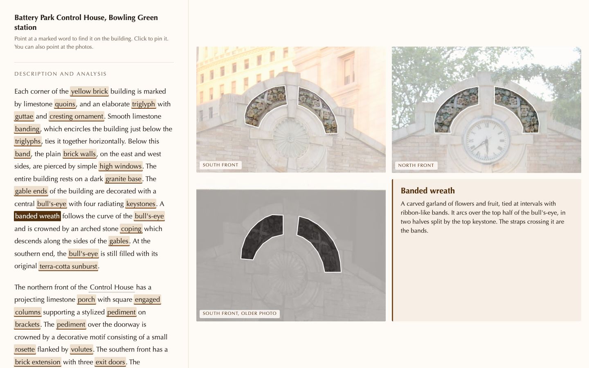

# Architecture glossary, on the building

Architectural descriptions are full of words like *triglyph*, *guttae* and *quoins*. This is a small web page that puts a written description next to photos of the building it describes. Point at a word and the thing it names lights up on every photo that shows it, with a plain-English definition.

**Live:** https://evanapplegate.github.io/architectureglossary/



The example is the Battery Park Control House, the 1905 subway entrance at Bowling Green in Manhattan, with two paragraphs from its 1973 landmark designation report.

It is one HTML file, one JSON file and some photos. No build step, no framework, no dependencies. You can fork it and point it at any building.

## Contents

- [Using the page](#using-the-page)
- [Run it locally](#run-it-locally)
- [What is in the repo](#what-is-in-the-repo)
- [How it works](#how-it-works)
- [Make one for another building](#make-one-for-another-building)
- [Data reference](#data-reference)
- [Change the look](#change-the-look)
- [Publish on GitHub Pages](#publish-on-github-pages)
- [Credits and licensing](#credits-and-licensing)

## Using the page

| Do this | And this happens |
| --- | --- |
| Point at a marked word | Every photo that shows the feature zooms to it and outlines it. Photos that do not show it fade out. The definition appears in the card. |
| Click a marked word | Pins it, so it stays selected when the pointer leaves. Click again to unpin. |
| Point at a photo | The feature under the pointer is named and outlined on all photos. No zoom, so the picture does not jump under your cursor. |
| Click a feature in a photo | Pins it and zooms in. Click empty photo to clear. |
| `←` `→` | Step through the words in reading order. |
| `Esc` | Clear the selection. |
| Add `#key` to the URL | Opens with that term pinned, e.g. [`#guttae`](https://evanapplegate.github.io/architectureglossary/#guttae). Keys are listed under [Data reference](#data-reference). |

Words with a dotted underline and no fill (here, "Control House") have a definition but are not a part of the building, so nothing is outlined.

On a wide window the text sits on the left and the photos form a grid on the right. Under 1100px wide, the photos run in a row across the top and the text scrolls below.

## Run it locally

```bash
git clone https://github.com/evanapplegate/architectureglossary.git
cd architectureglossary
python3 -m http.server 8000 --directory docs
```

Then open http://localhost:8000.

It has to be served over HTTP. Opening `docs/index.html` straight from disk will show the text but no outlines, because browsers block the page from loading `regions.json` on a `file://` address. Any static server works; Python's is just the one most machines already have.

## What is in the repo

```
docs/                  the published site (GitHub Pages serves this folder)
  index.html           page, styles, text, definitions and script, all in one file
  regions.json         outline coordinates, generated by tools/regions.py
  img/                 the photos
tools/                 only needed if you are tracing outlines
  regions.py           the outline coordinates, as readable Python (source of truth)
  grid.py              draws a percent grid over a photo so you can read coordinates off it
  verify.py            draws the outlines back onto a photo so you can check them
screenshot.png         the picture at the top of this README
```

The tools need Python 3 and [Pillow](https://pillow.readthedocs.io) (`python3 -m pip install pillow`). The site itself needs nothing.

## How it works

There are four pieces of data. Three live in `docs/index.html`, one in `docs/regions.json`.

1. **The text.** Ordinary HTML paragraphs. Each word or phrase to explain is wrapped in a span with a term key:
   ```html
   limestone <span class="t" data-k="quoins">quoins</span>, and an elaborate
   <span class="t" data-k="triglyph">triglyph</span>
   ```
   The same key can be used on several spans ("triglyph" and "triglyphs", "banding" and "band").

2. **The definitions**, in the `TERMS` object: a title, an optional pronunciation, a general definition and a note on what the thing is on this particular building.

3. **The photos**, in the `PHOTOS` object (file, pixel size, caption) and the `ORDER` array (which photo goes where).

4. **The outlines**, in `regions.json`: for each photo, for each term, a list of shapes in percent coordinates.

The script ties them together by key. Some behavior worth knowing before you add your own data:

- **Each photo is an SVG** with the picture inside it. Zooming is done by animating the SVG `viewBox`, so outlines and picture can never drift apart.
- **The spotlight** is a rectangle in the page background color at 60% opacity with the feature's shapes cut out of it by an SVG mask. The outline is a 2px white stroke that stays 2px at any zoom (`vector-effect: non-scaling-stroke`).
- **Zoom target.** The view is fitted to the bounding box of all the term's shapes on that photo, with padding. It never zooms in so far that the photo would be magnified much past its own pixels. If the shapes are small but far apart, like a triglyph at each end of the facade, it zooms to the first one instead of showing the whole photo.
- **Missing features.** If a photo has no shapes for the selected term, it fades to 25% so the eye goes to the photos that do.
- **Pointing at photos.** Every shape is also an invisible hit area. Big shapes are stacked under small ones, so you can reach a rosette that sits inside a pediment that sits inside a porch.
- **Reduced motion.** With the system "reduce motion" setting on, views jump instead of gliding.

## Make one for another building

You need: a description of a building, one to four photos of it, and an hour or two for tracing.

### 1. Pick the text and photos

Good descriptions come from landmark designation reports, National Register nominations, HABS/HAER surveys and architectural guidebooks. Dense is good: the more unfamiliar nouns per sentence, the more the page earns its keep.

For photos, straight-on and well-lit beats artistic. Between them the photos should show every side the text talks about. Higher resolution lets small details (guttae, rosettes) hold up when zoomed. Use photos you have the right to publish. See [Credits and licensing](#credits-and-licensing).

Put them in `docs/img/` and describe them in `PHOTOS` and `ORDER` near the top of the script in `docs/index.html`:

```js
const PHOTOS = {
  "north": { src: "img/north.jpg", w: 4752, h: 3168, label: "North front" },
  "south": { src: "img/south.jpg", w: 2223, h: 1479, label: "South front" },
};
const ORDER = ["south", "north"];
```

`w` and `h` must be the real pixel size of the file. The key (`"north"`) is what you will use in `regions.py`, and `verify.py` expects the file to be named `docs/img/<key>.jpg`.

### 2. Mark up the text

Replace the two paragraphs in `docs/index.html` with yours and wrap each term in `<span class="t" data-k="yourkey">`. Keys are yours to invent: short, lowercase, no spaces. For a word you want to define but cannot point to on the building, use `class="t note"`.

### 3. Write the definitions

One entry per key in `TERMS`:

```js
guttae: { name: "Guttae", say: "GUT-ee, Latin for \"drops\"",
  def: "The row of small pegs hanging under a triglyph, like drips or the heads of wooden pegs.",
  here: "Three stubby drops under each corner triglyph, overlapping the stone band." },
```

`def` is what the word means anywhere. `here` is what it looks like on this building, which is the part a dictionary cannot give you. They are shown together as one paragraph. For a `note` term, add `note: true` and leave out `here`.

### 4. Trace the outlines

This is the real work. Coordinates are **percent of the photo**, x from 0 at the left edge to 100 at the right, y from 0 at the top to 100 at the bottom.

Start with a full-frame grid to find your way around:

```bash
python3 tools/grid.py docs/img/north.jpg /tmp/north-grid.jpg --step 5
```

Then make a tight crop around each feature with a 1% grid. The four numbers are the crop, left top right bottom, in percent:

```bash
python3 tools/grid.py docs/img/north.jpg /tmp/corner.jpg 14 26 30 56 --step 1
```

Labels on a crop still read in percent of the full photo, so whatever you read off goes straight into `tools/regions.py`:

```python
N["triglyph"] = [R(17.5, 45.3, 22.5, 51.8), R(77.7, 45, 82.6, 51.5)]   # one at each corner
N["bullseye"] = [E(50, 24.6, 6, 8.8)]
N["keystones"] = [
    P((48.6, 9), (51.1, 9), (50.9, 18.8), (49.2, 18.8)),
    R(42.9, 23, 46.3, 25.3),
    ...
]
```

`R` is a rectangle, `E` an ellipse, `P` a polygon with as many points as you need. Each term gets a list because a feature often appears more than once.

Things learned the hard way:

- **Verify, do not trust.** Reading numbers off a grid is error-prone. Draw them back and look (next step) before moving on.
- **Trace what the word means, tightly.** A triglyph outline that also swallows the cap above it teaches the wrong thing.
- **Show the pattern.** For quoins, a stepped polygon that follows the long-short-long blocks explains the word better than a plain rectangle.
- **An ellipse is fine for a circle seen at an angle.** Give it different horizontal and vertical radii.
- **Leave it out if you cannot see it.** If a feature is in shadow or hidden, do not trace it on that photo. The photo will fade for that term, which is honest.
- **Dark photos:** add `--gamma 0.45` to brighten the picture for reading. It does not change the coordinates.
- **Nested features are fine.** Trace the porch, the pediment inside it and the rosette inside that. The page sorts hit areas by size on its own.

### 5. Check them

```bash
python3 tools/verify.py north /tmp/check.jpg 14 6 86 58 --only triglyph,guttae,cresting
```

This draws the named terms over the same crop, each in its own color with a label. Nudge the numbers in `regions.py` and rerun until the outlines sit on the stone. Leave off `--only` to see everything at once.

### 6. Export and look

```bash
python3 tools/regions.py
python3 -m http.server 8000 --directory docs
```

`regions.py` rewrites `docs/regions.json`. Open the page and step through every term with the arrow keys. This is where you catch a term with a definition but no outline, or a key spelled two ways.

## Data reference

### `regions.json`

```json
{
  "north": {
    "triglyph": [
      { "t": "p", "pts": [[17.5, 45.3], [22.5, 45.3], [22.5, 51.8], [17.5, 51.8]] }
    ],
    "bullseye": [
      { "t": "e", "c": [50, 24.6], "r": [6, 8.8] }
    ]
  },
  "south": { }
}
```

| Field | Meaning |
| --- | --- |
| top-level key | photo key, matching `PHOTOS` |
| second-level key | term key, matching `data-k` and `TERMS` |
| `t: "p"` | polygon; `pts` is a list of `[x, y]` points in percent |
| `t: "e"` | ellipse; `c` is the center `[x, y]`, `r` is `[horizontal radius, vertical radius]`, all in percent |

You can write this file by hand or generate it with anything. `tools/regions.py` is only a convenience.

### `TERMS`

| Field | Required | Meaning |
| --- | --- | --- |
| `name` | yes | Title shown in the card and in the tooltip over photos |
| `def` | yes | What the word means in general |
| `here` | no | What it is on this building |
| `say` | no | Pronunciation or an alternative name, shown small beside the title |
| `note` | no | `true` for a definition-only term with no outlines |

### `PHOTOS` and `ORDER`

| Field | Meaning |
| --- | --- |
| `src` | path to the image, relative to `index.html` |
| `w`, `h` | pixel size of that image file |
| `label` | caption shown on the photo |
| `ORDER` | photo keys in display order. On a wide window they fill a two-column grid left to right, with the definition card last. |

Any number of photos works. Three plus the card makes a tidy two-by-two.

### Term keys in the example

`yellowbrick` `quoins` `triglyph` `guttae` `cresting` `banding` `walls` `windows` `base` `gable` `bullseye` `keystones` `wreath` `coping` `sunburst` `porch` `columns` `pediment` `brackets` `rosette` `volutes` `extension` `doors` `enframement` `plainquoins` `entablature` `roof` `controlhouse`

## Change the look

Colors are CSS variables at the top of `docs/index.html`:

| Variable | Used for | Example value |
| --- | --- | --- |
| `--bg` | page background, and the wash over the un-selected part of a photo | `#FEFAF6` |
| `--ink` | body text | `#2b241d` |
| `--ink-soft` | secondary text | `#7d7165` |
| `--brown` | underline of marked words, fill of the active word, card accent | `#7a4a22` |
| `--brown-deep` | pinned word, card title | `#54310f` |
| `--tan` | resting fill of marked words | `#eedfcc` |
| `--panel` | definition card background | `#f7efe5` |
| `--rule` | divider lines | `#e9dfd3` |

Other knobs:

- **Typeface:** the `font` line on `body`. It is set to Optima, which ships with macOS; Windows falls back to Candara or Segoe UI.
- **Photo outline:** the `.outline` rule (color and width).
- **Wash strength:** `fill-opacity` on `.wash`.
- **How far it zooms:** the `Math.max(...)` line in `targetView()`. `1.8` is the padding around the feature; `P.w * 0.1` and `560` set the tightest view allowed.
- **Layout breakpoint:** the `@media (max-width: 1099px)` block.

## Publish on GitHub Pages

1. Push the repo to GitHub.
2. Repo **Settings → Pages → Build and deployment**: source "Deploy from a branch", branch `main`, folder `/docs`.
3. Wait a minute. The site appears at `https://<your-username>.github.io/<repo-name>/`.

All paths in the page are relative, so it works at any address without changes.

## Credits and licensing

**Text.** New York City Landmarks Preservation Commission, [designation report LP-0829](https://s-media.nyc.gov/agencies/lpc/lp/0829.pdf), "Battery Park Control House", November 20, 1973. The page uses the third and fourth paragraphs of its "Description and Analysis".

**Photos.** These belong to their photographers. They are not covered by any permission to reuse this repo, so do not copy them into your own project without checking the terms yourself.

| Photo | Credit | Terms |
| --- | --- | --- |
| South front (`south.jpg`) | [Wally Gobetz, "NYC - Battery: Battery Park Control House"](https://www.flickr.com/photos/wallyg/331816545/), 2006 | [CC BY-NC-ND 2.0](https://creativecommons.org/licenses/by-nc-nd/2.0/) |
| North front (`north.jpg`) | [Emilio Guerra, "Battery Park Control House (IRT Subway)"](https://www.flickr.com/photos/emilio_guerra/4875139507/), 2010 | All rights reserved |
| South front, older photo (`south-bw.jpg`) | Photographer unknown | Unknown |

If one of these is yours and you want it credited differently or removed, open an issue.

**Definitions.** Written for this page, in plain language. They are meant to get a newcomer oriented, not to settle arguments between architectural historians.

**Code and tools.** Free to reuse and adapt for your own building.
